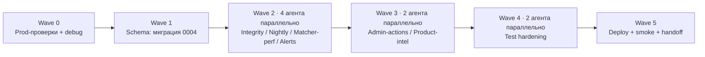

# otz-rent-finder — FEATURE PLAN

---

## ✅ СТАТУС ВЫПОЛНЕНИЯ (обновлено 19.06.2026)

**Этап H1 — ВЫПОЛНЕН** (12.06.2026). Все волны W0-W5 отработаны мультиагентно с spec+quality ревью
и gate `pytest` после каждой; ветка `stage-h1` → `main`, задеплоено на VPS. Тесты **105 → 207**.
Коммиты: `30c67e8`(plan) · `47d2d9a`(W1) · `21d2bb3`(W2) · `55a7034`(W3) · `0cc149c`(W4) · `8d957c8`(W5).
Итоги в `HANDOFF.md` §0.1. Единственное незакрытое — **W0-5 `rematch-all`** (требует согласования с
Дарьей, генерит доставки пачкой; бэкфилл обложек 4zida при этом выполнен).

**Этап H1.1 «Incident Hardening» — ВЫПОЛНЕН** (19.06.2026, коммит `c31a80e`). Внеплановый: реакция на
прод-инцидент 13.06 (отзыв Telethon-сессии → крэш-луп монитора 3 дня + спам OnFailure ×6). Мультиагентное
ревью (workflow: 4 ревьюера → состязательная проверка, 14 находок → 7 фиксов) + реализация + quality-пасс.
Тесты **207 → 220**. Детали — `HANDOFF.md` §0.0. Сводка задач — ниже, раздел **H1.1**.

---

## 🔥 Этап H1.1 · «Incident Hardening» (внеплановый, 19.06.2026) — ВЫПОЛНЕН

**Триггер:** 13.06 владелец случайно «завершил все сеансы» Telegram → `SessionRevokedError` →
монитор при рестарте звал интерактивный `start()` в сервисе → `EOFError`/`Aborted!` → крэш-луп 6× →
`failed` на 3 дня; `OnFailure` сработал на каждый рестарт (спам). SMS-реавторизация невозможна
(`SentCodeTypeApp`/`next_type=None` при живой app-сессии). Восстановлено **QR-входом**.

| ID | Фикс | Файлы | Статус |
|---|---|---|---|
| H1.1-1 | `connect_authorized()` — нет интерактивного `start()` в сервисе; отзыв/нет сессии → один алерт через бот + `exit 3`; рантайм `UnauthorizedError`/`AuthKeyDuplicatedError` ловится так же | `monitor.py`, `cli.py` (`_monitor`, `_open_userbot_if_needed`) | ✅ |
| H1.1-2 | `RestartPreventExitStatus=3` — потеря сессии = один `failed`/алерт, без лупа (exit 3 сквозь `xvfb-run` проверен на проде) | `scripts/vps_install.sh` | ✅ |
| H1.1-3 | Де-дуп нотификатора (маркер `/var/log/otz/.last_alert_<unit>`, cooldown ~10 мин) — smoke ×2 → 1 отправка | `cli.py` (`_notify_failure`) | ✅ |
| H1.1-4 | Исправлена ложная модель «OnFailure только при исчерпании рестартов» | `vps_install.sh`, `PHASE5_DEPLOY §5.4`, `HANDOFF §5.4` | ✅ |
| H1.1-5 | `scripts/auth_qr.py` — QR-реавторизация (ASCII+PNG QR, `OTZ_2FA`, `OTZ_SESSION`, коды возврата); `qrcode` в `pyproject`; HANDOFF §5.4 переписан (QR — основной, описан режим отказа SMS) | `scripts/auth_qr.py`, `pyproject.toml`, доки | ✅ |
| H1.1-6 | Бюджет ночного refetch: общий wall-clock `NIGHTLY_REFETCH_BUDGET_SEC=7200` на heal+rolling + per-fetch `asyncio.wait_for` cap `REFETCH_PER_FETCH_TIMEOUT_SEC=90` (страховка от SIGTERM 16.06) | `orchestrator.py`, `cli.py` (`_run_nightly_steps`), `config.py` | ✅ |

**Проверено на проде:** монитор перезапущен на hardened-код (`active`, NRestarts=0), `RestartPreventExitStatus=3`
на живом юните, `xvfb-run` сохраняет exit 3, де-дуп алертов работает (smoke ×2 → 1 сообщение), `qrcode` ставится.
**Остаточные мелочи** (в бэклог HANDOFF §0.3): `--reason` из systemd для notify-failure пропущен; root cause
SIGTERM 16.06 не найден (не воспроизводится, смягчён бюджетом).

---

## Этап H1 · «Hardening & Intelligence»

> **Дата плана:** 2026-06-12 · **База:** `HANDOFF.md` (handoff 12.06), коммиты `3169d92`, `32f5c67`
> **Исполнение:** Claude Code, multi-agent (Task tool) · **Оркестратор:** главная сессия
> **Память проекта:** `~/.claude/projects/-Users-mvstrike-BelgradAppartment/memory/` — прочитать до старта

**Цель этапа:** закрыть P1/P2 бэклог ревью (целостность данных + перфоманс), добавить наблюдаемость (алерты, метрики) и три продуктовые фичи (admin-actions, LLM-тюнинг, price-drop алерты), укрепить тестами непокрытые зоны.

**Не входит в этап** (принято осознанно, см. HANDOFF §0.3 P3):
- throttle-маркер и параллельные скрапы — известно, ок;
- потеря ~200 объявлений halooglasi из-за ротации — самолечится 3-дневным grace;
- детерминизация pHash-vs-CLIP выбора сигнала — отдельный PR со сменой семантики (см. W4-T3, optional);
- любые публикации в @RentBelgrad из бота — никогда (правило проекта).

---

## 0. Правила оркестрации (читать оркестратору первым)

1. **Волны выполняются строго последовательно.** Внутри волны агенты запускаются **параллельно** через Task tool.
2. **Файловое владение.** Каждый агент меняет ТОЛЬКО файлы из своего брифа (см. карту владения в каждой волне). Два параллельных агента никогда не владеют одним файлом. Единственное исключение помечено явно (W2-D ↔ `cli.py`, одна функция).
3. **Alembic — single-owner.** Все изменения схемы делает один агент в Wave 1. В других волнах миграции запрещены.
4. **Субагенты НЕ делают:** `git commit/push`, `ssh`, любые действия на VPS, правки `.env`, изменения вне своего scope.
5. **Коммитит оркестратор** — один коммит на волну: `stage-h1: wave N — <summary>`.
6. **Gate после каждой волны:** `.venv/bin/pytest tests/ -q` — весь сьют зелёный (105 + новые). Волна не закрыта, пока gate красный.
7. **Любое действие на VPS** (Wave 0 и Wave 5) — только оркестратор и только после явного подтверждения пользователя. Перед миграцией БД на проде — обязательный backup.
8. **Стиль проекта:** лаконичные комментарии только для нетривиального WHY; model id без date-суффиксов (`claude-haiku-4-5`); деплой = rsync (`scripts/deploy_sync.sh`), не git.
9. Каждый агент в конце отдаёт **отчёт**: изменённые файлы · новые/обновлённые тесты · открытые риски · что проверить на проде.

### Карта волн



| Волна | Режим | Агенты | Содержание | Gate |
|---|---|---|---|---|
| W0 | sequential, оркестратор + ssh | — | Проверки прода из HANDOFF §0.2, запуск 7-часового бэкфилла | отчёт о состоянии |
| W1 | sequential, 1 агент | `db-migrator` | Миграция 0004: индексы, partial unique, новые колонки/таблица | pytest + upgrade/downgrade на копии БД |
| W2 | **parallel ×4** | `monitor-integrity`, `nightly-pipeline`, `matcher-perf`, `alerts-systemd` | Весь P1+P2 бэклог + алерты | pytest |
| W3 | **parallel ×2** | `admin-actions`, `product-intel` | Admin editing+CSRF, llm-report, districts-report, price-drop | pytest |
| W4 | **parallel ×2** | `tests-matcher`, `tests-monitor` | Покрытие stages 2-4 и event-handling | pytest |
| W5 | sequential, оркестратор + ssh | — | Backup → deploy → migrate → restart → smoke → обновить HANDOFF | smoke-чеклист |

**Метки:** сложность S / M / L · риск 🟢 низкий / 🟡 средний / 🔴 высокий (трогает прод-данные или live-pipeline).

---

## 🔎 Wave 0 — Prod-проверки и отладка (HANDOFF §0.2)

Без кода. Оркестратор, ssh с подтверждением пользователя. Результат — короткий статус-отчёт; находки конвертируются в задачи (если что-то сломано — чинится ДО Wave 1).

- [x] **W0-1 · Ночная сводка за 13.06** (таймер 03:14 UTC). Ожидание: «Обновлено (active)» ~20-21k; у всех трёх площадок строка «покрытие N% из M» (halooglasi теперь шлёт TotalCount). Если 🚨 или «Sweep пропущен» → `/var/log/otz/nightly-refresh.log`, дебаг по §9.
- [x] **W0-2 · Heal-юнит `otz-adhoc-20260612-075956`** (refetch-details, ~594 битые строки) — завершился? Остаток битых:
  `ssh root@90.156.254.159 'sqlite3 /opt/otz/data/otz.db "SELECT platform, SUM(photo_phashes=''[]'') FROM listings WHERE is_active=1 GROUP BY platform"'`
- [x] **W0-3 · Скорость матчера на проде**: в `/var/log/otz/monitor.log` новые inbound должны матчиться за секунды (было 40-75с). Если нет — стоп, дебаг до продолжения этапа.
- [x] **W0-4 · Запустить бэкфилл обложек 4zida** (старые строки): `ssh root@90.156.254.159 'otz-bg refetch-details --platform cetiri_zida --all'` — ~7ч, **запускать утром**, чтобы не пересечься с ночным таймером 03:00 UTC. Идёт фоном параллельно волнам 1-4 (только чтение кода, конфликтов нет).
- [ ] **W0-5 · После W0-4**: `otz-bg rematch-all` для перепроверки старых NO_MATCH inbound'ов (по согласованию — генерит доставки Дарье, предупредить её заранее).

---

## 🧱 Wave 1 — Schema (агент `db-migrator`, sequential)

Один агент, потому что alembic revision chain не переживает параллельные правки.

**Владение:** `alembic/versions/0004_*.py` (новый), `src/db/models.py`, при необходимости `tests/test_models*.py`.

### W1-1 · Миграция 0004 — `M` · 🟡

Содержимое (всё в одной ревизии):

1. **Индексы под sweep и выборки** (P1): `ix_listings_last_seen_at` на `listings(last_seen_at)`; составной `ix_listings_platform_active` на `listings(platform, is_active)`. Сейчас sweep сканирует 30k+ строк.
2. **Partial unique против гонки дедупа inbound** (P1, `src/db/models.py:92-96`): SQLite считает NULL различными в UNIQUE, поэтому тройной ключ `(source_channel_id, tg_message_id, digest_share_id)` не ловит дубли при `digest_share_id IS NULL`. Добавить:
   ```python
   op.create_index(
       "uq_inbound_chan_msg_nodigest", "inbound_posts",
       ["source_channel_id", "tg_message_id"],
       unique=True, sqlite_where=sa.text("digest_share_id IS NULL"),
   )
   ```
   **Перед созданием** — дедуп существующих NULL-дублей: оставить строку с min(id), у удаляемых каскадно убрать `matches` и `published_posts`, залогировать количество (ожидается 0-единицы).
3. **`listings.details_refreshed_at`** (DATETIME, nullable) — под rolling re-fetch (W2-C2). NULL = «никогда не обновлялись», сортировка `ASC NULLS FIRST` (в SQLite NULL и так первые).
4. **Таблица `daily_metrics`** — под drop-алерт (W2-C5) и дашборд (W3-F3):
   `id PK · snapshot_date TEXT · platform TEXT · active_count INT · no_photo_count INT · UNIQUE(snapshot_date, platform)`.

**AC:**
- `alembic upgrade head` и `downgrade -1` проходят на копии реальной схемы (создать throwaway-БД из моделей + сидировать пару NULL-дублей для проверки дедупа в п.2);
- `models.py` синхронизирован (индексы/колонки/таблица объявлены и в моделях);
- pytest зелёный; ни одна существующая миграция не тронута.

**Риск:** дедуп в п.2 удаляет данные → миграция обязана логировать, что удалила; на проде применяется только после backup (Wave 5, шаг 2).

---

## ⚙️ Wave 2 — Integrity + Performance + Alerts (4 агента параллельно)

### Карта владения W2

| Агент | Владеет | Запрещено |
|---|---|---|
| **B · monitor-integrity** | `src/telegram/monitor.py`, `tests/test_monitor_dedup.py` (новый) | всё остальное |
| **C · nightly-pipeline** | `src/cli.py` (кроме функции match-all), `src/scrapers/orchestrator.py`, тесты к своим шагам | `src/matching/*`, функция match-all в `cli.py` |
| **D · matcher-perf** | `src/matching/matcher.py`, **только функция match-all внутри `cli.py`** (исключение из правила 2, зафиксировано здесь), тесты | остальной `cli.py`, `orchestrator.py` |
| **E · alerts-systemd** | `scripts/vps_install.sh`, unit-шаблоны в `scripts/`, `docs/` | весь `src/` |

### Агент B · `monitor-integrity`

#### W2-B1 · Закрыть гонку дедупликации inbound — `M` · 🔴 (P1)

Код-половина задачи (индекс уже в W1). В `src/telegram/monitor.py:354-382`:
- pre-insert check существующего inbound по `(source_channel_id, tg_message_id)` с учётом `digest_share_id IS NULL`;
- insert обёрнут в `try/except IntegrityError` → повторный select → использовать существующую строку, **не** запускать pipeline второй раз (иначе дубль-пост и двойная доставка Дарье).

**AC:** тест с двумя конкурентными корутинами на in-memory БД с применённым partial-индексом — в БД ровно одна строка, pipeline вызван один раз. Поведение для не-NULL `digest_share_id` не изменилось.

### Агент C · `nightly-pipeline`

Общие требования ко всем новым ночным шагам: каждый шаг **отключаем через env** (`=0` → skip), логирует счётчики в сводку, обёрнут в try/except — падение шага даёт 🚨-строку в сводке, но не валит nightly (базовый скрап — исключение, он по-прежнему фатален).

#### W2-C1 · Auto-heal битых строк — `S` · 🟢 (P1)

После скрапа + sweep: `refetch-details` в режиме broken-only с лимитом `NIGHTLY_HEAL_LIMIT` (default 500). Сейчас heal только вручную. В сводку: «heal: исправлено X / осталось Y».

#### W2-C2 · Rolling re-fetch деталей (протухшие цены) — `M` · 🟡 (P1)

Детали существующих listings никогда не обновляются — цена на сайте меняется, у нас старая. Каждую ночь: выбрать `NIGHTLY_DETAIL_REFRESH` (default 200) активных listings с минимальным `details_refreshed_at` (NULLs first), поровну по платформам; re-fetch деталей; обновить поля + `details_refreshed_at = now()`. Собрать список `(listing_id, old_price, new_price)` и **вернуть из шага** — на него в W3-G3 повесится price-drop алерт. В сводку: «деталей обновлено: N, цен изменилось: M». 21.8k активных / 200 в ночь ≈ полный цикл ~3.5 месяца — ок для старта, лимит крутится через env.

#### W2-C3 · Прунинг `photo_embeddings` неактивных — `S` · 🟡 (P2)

~60% из 415МБ BLOB'ов — мёртвый вес, растёт бесконечно:
```sql
UPDATE listings SET photo_embeddings = NULL
WHERE is_active = 0 AND last_seen_at < date('now','-30 day') AND photo_embeddings IS NOT NULL;
```
Шаг в nightly + счётчик в сводку. **Примечание в docs:** файл БД не уменьшится без `VACUUM`; VACUUM — только ручной, с backup и остановленным monitor (добавить сниппет в HANDOFF §15).

#### W2-C4 · `embed-all` / `hash-listings` без полных ORM-строк — `S` · 🟢 (P2)

`src/cli.py:~694-772` грузит полные строки с BLOB'ами только чтобы выбрать id. Перейти на выборку колонок (`select(Listing.id, ...)`), BLOB'ы не поднимать. AC: функциональная эквивалентность (тот же набор id), память на 21.8k строк не растёт на сотни МБ.

#### W2-C5 · Snapshot метрик + алерт на просадку active — `M` · 🟢 (фича)

После sweep писать в `daily_metrics` (W1-1 п.4) по каждой платформе: `active_count`, `no_photo_count`. Сравнить с предыдущим snapshot: падение `active_count` >20% за сутки по любой платформе → 🚨-строка в ночной сводке + отдельное сообщение через `send_text_to_recipients`. Это страховка от «скрапер тихо умер, sweep всех погасил».

#### W2-C6 · Покрытие фотографиями в daily-summary — `S` · 🟢 (фича)

В утреннюю сводку: активные listings без фото по платформам (из `daily_metrics.no_photo_count` или живым запросом).

#### W2-C7 · Поправить докстринг `notify-failure` — `S` · 🟢 (P3)

`cli.py:~1489` обещает `OnFailure=`-wiring. Wiring делает агент E (W2-E1) — докстринг привести в соответствие реальности.

### Агент D · `matcher-perf`

#### W2-D1 · Вынести CPU-скан матчера из event loop — `M` · 🟡 (P2)

Остаточный ~1с CPU (pHash XOR/popcount + CLIP cosine) всё ещё блокирует loop. Вынести скан в `asyncio.to_thread`: все данные пре-фетчатся **до** входа в thread, внутри — чистый CPU, никаких session/ORM/await. AC: тест бит-в-бит эквивалентности результатов на фикстурах; в проде матч новых inbound идёт в фоне, monitor не «замирает».

#### W2-D2 · Кэш кандидатов для `match_all_pending` — `M` · 🟡 (P2)

Сейчас полный SELECT на каждый inbound. Сделать `load_candidate_cache(session)` в `src/matching/` — lightweight-строки (id, phash-ints, цена, площадь, платформа) один раз на батч; `match_inbound(..., cache=...)` опционально принимает кэш (default None → старое поведение, live-monitor не трогаем). В `cli.py` правится **только** функция match-all (см. карту владения). AC: `rematch-all` на фикстурах даёт идентичные матчи; один SELECT кандидатов на батч вместо N.

### Агент E · `alerts-systemd`

#### W2-E1 · `OnFailure=` алерты для всех юнитов — `M` · 🟢 (P3 + идея §18)

- Новый шаблонный юнит `otz-notify-failure@.service` (oneshot, `User=otz`, `ExecStart=/opt/otz/.venv/bin/otz notify-failure %i`) — добавить в `scripts/vps_install.sh`;
- `OnFailure=otz-notify-failure@%n.service` в `otz-monitor.service`, `otz-nightly-refresh.service`, `otz-daily-summary.service`;
- проверить `Restart=`/`StartLimit*` у monitor: OnFailure должен срабатывать, когда рестарты исчерпаны, а не на каждый рестарт.

Алерт уходит через бот (`send_text_to_recipients` внутри существующей CLI-команды). **AC:** `vps_install.sh` идемпотентен; код юнитов проходит `systemd-analyze verify` (если доступен локально — иначе ручная проверка синтаксиса); в Wave 5 — живой smoke: `systemctl start otz-notify-failure@smoke.service` → сообщение в боте. Тестов в pytest нет — это инфра, проверяется на проде.

---

## 🧩 Wave 3 — Продуктовые фичи (2 агента параллельно)

W3 стартует после мержа W2 — поэтому `cli.py` и `orchestrator.py` снова свободны и переходят агенту G.

### Карта владения W3

| Агент | Владеет | Запрещено |
|---|---|---|
| **F · admin-actions** | `src/admin/*`, `tests/test_admin*.py` | всё остальное |
| **G · product-intel** | `src/cli.py`, `src/matching/llm_validator.py`, `src/scrapers/orchestrator.py` (хук price-drop), тесты | `src/admin/*`, `src/telegram/monitor.py` |

### Агент F · `admin-actions`

#### W3-F1 · Действия над match в админке — `M` · 🟡 (расширение §18)

Админка сейчас read-only. Добавить минимум: **Reject** (match → REJECTED, выпадает из очереди) и **Mark posted** (→ PUBLISHED, для случаев «Дарья запостила, бот не знает»). Кнопки на странице очереди + confirm. Бот в канал по-прежнему НЕ публикует — это только разметка статусов.

#### W3-F2 · CSRF на POST-роутах — `S` · 🟢 (P3, `src/admin/routes.py:94-142`)

Токен (cookie/session + hidden input) на все POST-формы, включая новые из F1. Fail-closed. Риск был низкий (localhost + basic auth), но с появлением write-действий — обязателен.

#### W3-F3 · Страница `/metrics` — `M` · 🟢 (stretch, §18 «Метрики»)

График `active_count` по платформам из `daily_metrics` (Chart.js с CDN — админка localhost, ок) + таблица последних snapshot'ов. Если время волны поджимает — выносится в следующий этап без последствий.

**AC (F):** тесты: POST без CSRF-токена → 403; reject/mark-posted меняют статус и идемпотентны; read-only страницы не сломаны.

### Агент G · `product-intel`

#### W3-G1 · Лог LLM-вердиктов + `otz llm-report` — `M` · 🟢 (тюнинг §18)

Порог 0.7 иногда режет легитимные матчи, но тюнить его вслепую нельзя. Сделать данные:
- `llm_validator.py` пишет JSON-line в `data/logs/llm_decisions.jsonl`: inbound_id, listing_id, verdict, confidence, latency_ms, model;
- команда `otz llm-report --days N`: распределение confidence, сколько матчей прошло бы при 0.6 / 0.65 / 0.7, список пограничных (0.55–0.75) с url'ами для ручной проверки.

Решение о смене `LLM_VALIDATION_MIN_CONFIDENCE` — отдельно, руками, после 2-3 недель данных. В этом этапе порог НЕ меняем.

#### W3-G2 · `otz districts-report` — `S` · 🟢

Топ raw-значений district у активных listings, отсутствующих в `data/districts.yaml`, с частотами + готовые строки yaml для вставки. Закрывает ручную рутину «появился новый микрорайон». Напоминание в выводе: districts.yaml — единственный синкаемый data-файл (`deploy_sync.sh`).

#### W3-G3 · Price-drop алерты — `M` · 🟡 (новая фича)

На результат W2-C2 (список `(listing_id, old_price, new_price)` из rolling re-fetch): если цена упала ≥ `PRICE_DROP_MIN_PCT` (default 5%) И listing связан с match в статусе PENDING/PUBLISHED → сообщение в бот: «📉 Цена снизилась: {old}€ → {new}€» + url listing + ссылка на исходный inbound. Флаг `PRICE_DROP_ALERTS=true` (default true). Это прямой value для Дарьи: повод переопубликовать квартиру с новой ценой.

**AC (G):** тесты на report-команды (фикстуры jsonl/БД) и на фильтр price-drop (порог, статусы, флаг off).

---

## 🧪 Wave 4 — Test hardening (2 агента параллельно)

Только новые тестовые файлы — конфликтов нет по построению. Закрывает P3 «не покрыто».

| Агент | Владеет |
|---|---|
| **T1 · tests-matcher** | `tests/test_matcher_stages.py` (новый), фикстуры |
| **T2 · tests-monitor** | `tests/test_monitor_events.py` (новый), фикстуры |

#### W4-T1 · Stages 2-4 матчера — `M` · 🟢

Mock `clip_embed` (фиксированные векторы) и `llm_validator` (программируемые вердикты). Сценарии: CLIP-кандидат + text mismatch (цена/площадь) → reject; LLM fail-open при exception / 529 OverloadedError → остаётся CLIP-вердикт; LLM reject ниже порога; корректные `method`-метки (`phash` / `clip` / `clip+llm`); `min_matched_photos=2` соблюдается.

#### W4-T2 · Event-handling монитора — `M` · 🟢

Прямые вызовы handler'ов с фейковыми событиями: альбом группируется по `grouped_id` + flush по таймеру; watermark двигается только после успешной обработки; дубликат message id скипается (опирается на W2-B1); порядок backfill.

#### W4-T3 · (optional, вне DoD) Детерминизация pHash-vs-CLIP

Выбор сигнала зависит от порядка обхода listings (running `best_score`, `src/matching/matcher.py`) — сохранено сознательно при рефакторе. Если делать — отдельный PR с осознанной сменой семантики и прогоном `test-batch` до/после. В этап не входит, зафиксировано чтобы не потерялось.

---

## 🚀 Wave 5 — Deploy + smoke + handoff (оркестратор, ssh с подтверждением)

> Критичные правила HANDOFF §0.4 действуют дословно: деплой = rsync, не git; `.env` руками; `data/` rsync'ом не трогать; CLI на сервере как `otz`/`otz-bg`, не root.

Runbook по шагам, **каждый ssh — после подтверждения пользователя**:

1. Локально: `.venv/bin/pytest tests/ -q` — весь сьют зелёный.
2. **Backup БД:** `ssh root@90.156.254.159 'cp /opt/otz/data/otz.db /opt/otz/data/backups/otz-$(date +%F-%H%M).db'`
3. `ssh root@90.156.254.159 'systemctl stop otz-monitor.service'` — на время миграции (SQLite DDL + session lock §13.1).
4. `bash scripts/deploy_sync.sh` (без `--restart`, monitor и так остановлен).
5. Миграция: `ssh root@90.156.254.159 'sudo -u otz bash -c "cd /opt/otz && .venv/bin/alembic upgrade head"'` — в логе должен отчитаться дедуп NULL-дублей (W1-1 п.2).
6. Юниты: применить изменения из W2-E (новый `otz-notify-failure@.service`, `OnFailure=` в трёх юнитах) → `systemctl daemon-reload`.
7. `systemctl start otz-monitor.service` → `journalctl -u otz-monitor -n 30` — чистый старт.
8. **Smoke:**
   - `otz-bg stats` — счётчики на месте;
   - `otz-bg test-batch 3` — pipeline end-to-end, матчи за секунды;
   - `systemctl start otz-notify-failure@smoke.service` — алерт прилетел в бот;
   - следующее утро: ночная сводка содержит новые строки (heal / details refreshed / prune / metrics / 🚨-блок).
9. Обновить `HANDOFF.md` §0 (новый статус, новые env-ключи, новые команды) и `docs/SPEC.md` («Этапы разработки» — закрыть этап H1). Новые env-ключи задокументировать в `.env.example`: `NIGHTLY_HEAL_LIMIT`, `NIGHTLY_DETAIL_REFRESH`, `PRICE_DROP_ALERTS`, `PRICE_DROP_MIN_PCT`.
10. Коммит + push в `github.com/MWildFire/BelgradAppartment`.

**Rollback:** код — `git revert` + `deploy_sync.sh --restart`; схема — `alembic downgrade -1` (monitor остановить); данные — restore backup из шага 2 (monitor остановить!).

---

## 🐞 Debug-протокол (для всех агентов и оркестратора)

**Локально:** воспроизведение через fixtures (`tests/fixtures/`) или `test-batch` на VPS; один найденный баг = один регрессионный тест в том же PR; `pytest -k <name> -x -q` для итераций.

**Прод — карта «симптом → куда смотреть»:**

| Симптом | Первый шаг |
|---|---|
| Monitor молчит / не матчит | `journalctl -u otz-monitor -f`; «disk I/O error» → session lock §13.1 (кто-то трогает `otz_monitor.session`) |
| Матч снова медленный (>10с) | тайминги в `/var/log/otz/monitor.log`; проверить, что W2-D1 задеплоен и monitor перезапущен (старый код живёт в памяти!) |
| Ночной прогон с 🚨 / «Sweep пропущен» | `/var/log/otz/nightly-refresh.log`; покрытие <70% → смотреть сегментацию ценовых диапазонов конкретной площадки |
| Дубль-доставка Дарье | `sqlite3 ... "SELECT inbound_post_id, COUNT(*) FROM matches GROUP BY 1 HAVING COUNT(*)>..."` + проверить partial-индекс W1-1 п.2 применён |
| FloodWait / `tg_message_id=0` | §13.5 → `otz-bg deliver-all --force` |
| Adhoc-команда «пропала» после disconnect | она жива: `journalctl -u otz-adhoc-<TS> -f`; tail сам прилетит в Saved Messages |
| Ownership сломан после ручного rsync | `chown -R otz:otz /opt/otz`; больше никогда `rsync -a` (§13, история 14.5) |

**Квирки, которые НЕ баги** (не «чинить» случайно): LLM non-determinism (§13.4 — `test-batch` может дать другую раскладку), throttle race (§13.2), ротация halooglasi mid-walk.

---

## 🤖 Шаблон промпта субагента (копировать оркестратору)

```text
Ты — субагент Claude Code на проекте otz-rent-finder.
Контекст: прочитай HANDOFF.md (минимум §0, §0.4, §16, §17 + секции, указанные в задаче)
и свою задачу <ID> в docs/FEATURE_PLAN.md.

Scope: разрешено менять ТОЛЬКО эти файлы: <список из карты владения волны>.
Запрещено: git commit/push, ssh, действия на VPS, правки .env, файлы вне scope,
изменения alembic (кроме агента db-migrator в Wave 1).

Порядок: 1) прочитай связанный код и секции HANDOFF; 2) реализуй по AC задачи;
3) добавь/обнови тесты; 4) прогони ВЕСЬ сьют: .venv/bin/pytest tests/ -q;
5) верни отчёт: изменённые файлы · новые тесты · риски · что проверить на проде.

Стиль: лаконичные комментарии только для нетривиального WHY; model id без
date-суффиксов (claude-haiku-4-5); ничего не публиковать в @RentBelgrad.
```

---

## ✅ Definition of Done этапа H1

- [~] W0: проверки + бэкфилл 4zida закрыты; **`rematch-all` НЕ прогнан** (по согласованию с Дарьей — см. HANDOFF §0.2)
- [x] Весь P1 закрыт: auto-heal в nightly · гонка дедупа (индекс + код + тест) · индексы listings · rolling re-fetch деталей
- [x] Весь P2 закрыт: column-select в embed-all/hash-listings · прунинг embeddings · кэш match-all · CPU-скан в to_thread
- [x] P3 закрыт частично (план): CSRF · notify-failure wiring + докстринг · тесты stages 2-4 и monitor events
- [x] Фичи: OnFailure-алерты · drop-алерт active>20% · photo coverage в сводке · admin reject/mark-posted · `/metrics` (или явно перенесён) · llm-report · districts-report · price-drop алерты
- [x] `pytest -q` зелёный — **207** тестов после H1 (база 105), **220** после H1.1
- [x] Прод: миграция применена после backup, monitor перезапущен, smoke из W5-8 пройден
- [x] `HANDOFF.md` §0, `docs/SPEC.md`, `.env.example` обновлены; коммит запушен

---

## Приложение А — сводная таблица задач

| ID | Задача | Агент | Волна | Слож. | Риск | Источник |
|---|---|---|---|---|---|---|
| W0-1..5 | Prod-проверки + бэкфилл 4zida | оркестратор | 0 | S | 🟡 | §0.2 |
| W1-1 | Миграция 0004 (индексы, partial unique, колонка, daily_metrics) | db-migrator | 1 | M | 🟡 | P1 |
| W2-B1 | Гонка дедупа inbound (код) | monitor-integrity | 2 | M | 🔴 | P1 |
| W2-C1 | Auto-heal в nightly | nightly-pipeline | 2 | S | 🟢 | P1 |
| W2-C2 | Rolling re-fetch деталей | nightly-pipeline | 2 | M | 🟡 | P1 |
| W2-C3 | Прунинг photo_embeddings | nightly-pipeline | 2 | S | 🟡 | P2 |
| W2-C4 | embed-all/hash-listings: колонки вместо ORM | nightly-pipeline | 2 | S | 🟢 | P2 |
| W2-C5 | daily_metrics + алерт просадки active | nightly-pipeline | 2 | M | 🟢 | идея |
| W2-C6 | Photo coverage в daily-summary | nightly-pipeline | 2 | S | 🟢 | идея |
| W2-C7 | Докстринг notify-failure | nightly-pipeline | 2 | S | 🟢 | P3 |
| W2-D1 | CPU-скан матчера → to_thread | matcher-perf | 2 | M | 🟡 | P2 |
| W2-D2 | Кэш кандидатов match-all | matcher-perf | 2 | M | 🟡 | P2 |
| W2-E1 | OnFailure-алерты (systemd) | alerts-systemd | 2 | M | 🟢 | P3+§18 |
| W3-F1 | Admin: reject / mark-posted | admin-actions | 3 | M | 🟡 | §18 |
| W3-F2 | CSRF на admin POST | admin-actions | 3 | S | 🟢 | P3 |
| W3-F3 | Страница /metrics (stretch) | admin-actions | 3 | M | 🟢 | §18 |
| W3-G1 | llm_decisions.jsonl + llm-report | product-intel | 3 | M | 🟢 | §18 |
| W3-G2 | districts-report | product-intel | 3 | S | 🟢 | §18 |
| W3-G3 | Price-drop алерты | product-intel | 3 | M | 🟡 | новая |
| W4-T1 | Тесты matcher stages 2-4 | tests-matcher | 4 | M | 🟢 | P3 |
| W4-T2 | Тесты monitor events | tests-monitor | 4 | M | 🟢 | P3 |
| W4-T3 | Детерминизация сигнала (optional, вне DoD) | — | — | M | 🟡 | quirk |
| W5 | Deploy runbook + handoff | оркестратор | 5 | M | 🔴 | — |
