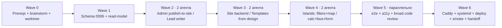

# Stage W — «Public Web Catalog» · План для Claude Code

> **Дата:** 2026-06-20 · **Проект:** otz-rent-finder · **Ветка:** `feature/public-web-catalog`
> **База:** `HANDOFF.md`, `docs/SPEC.md`, `docs/web/ARCHITECTURE.md`, `docs/web/DATA_CONTRACT.md`, дизайн в `design/`
> **Методология:** **obra/superpowers** (обязательно) · multi-agent · TDD (red/green) · код-ревью на каждом шаге
> **Память проекта:** `~/.claude/projects/-Users-mvstrike-BelgradAppartment/memory/` — прочитать до старта

**Цель:** дать клиентам @RentBelgrad удобную веб-витрину (каталог + фильтры ВНЖ/картон + карта + калькулятор + заявка) на **дизайн-системе «Belgrade Editorial»**, развёрнутую **на той же VPS, что и бот**, читающую **существующую БД** без повторного ингеста. Архитектурное обоснование и развязка через `site_listings`/`leads` — в `docs/web/ARCHITECTURE.md`. Контракт backend↔frontend — в `docs/web/DATA_CONTRACT.md`.

**Этот план ОТМЕНЯЕТ** разделы 1 (стек Astro/Vercel), 3 (ингест из Telegram) и хостинг дизайн-плана `design/DESIGN_PLAN.md`. **СОХРАНЯЕТ** дословно его раздел 0 (анти-slop закон), палитру, типографику, геометрию, микрокопирайт и «вкусовые» ревью-скиллы (`taste`, `impeccable`).

---

## 0. Superpowers — как используем (обязательно)

### 0.1 Установка плагина (один раз, до старта)

```bash
# официальный маркетплейс Anthropic:
/plugin install superpowers@claude-plugins-official
# либо маркетплейс автора:
/plugin marketplace add obra/superpowers-marketplace
/plugin install superpowers@superpowers-marketplace
```

Скиллы триггерятся автоматически. Перед стартом анонсировать: *«Использую superpowers для этого этапа»*.

### 0.2 Карта скиллов Superpowers → фазы этапа

| Скилл | Где применяется |
|---|---|
| `using-superpowers` | корневой раннер, держит чек-лист фаз |
| `brainstorming` | Wave 0 — финализировать спорные продуктовые вопросы с Дмитрием/Дарьей до кода |
| `writing-plans` | этот файл (формат, bite-sized задачи, TDD, частые коммиты) |
| `using-git-worktrees` | Wave 0 — изолированный worktree под `feature/public-web-catalog` |
| `subagent-driven-development` | Waves 1–5 — свежий implementer-субагент на задачу + ревью после каждой + широкое финальное ревью |
| `dispatching-parallel-agents` | Waves 2–5 — один агент на независимый домен, изолированный контекст |
| `test-driven-development` | каждая задача с кодом — **сначала падающий тест**, потом минимальная реализация |
| `requesting-code-review` + `receiving-code-review` | ревью-гейт после каждой задачи и широкое в Wave 5 |
| `systematic-debugging` | любые баги в Wave 5 и на проде (Wave 6) — гипотеза→изоляция→фикс→регресс-тест |
| `verification-before-completion` | перед закрытием каждой волны и этапа |
| `finishing-a-development-branch` | Wave 6 — финализация ветки, мерж, очистка |

### 0.3 «Вкусовые» скиллы из дизайн-плана (для UI-ревью, не из superpowers)

Применять в Wave 3–5 как ревью-проход по внешнему виду (каркас из генераторов компонентов — это **черновик**, не финал): `taste-skill` (ритм/контраст/«не slop ли»), `impeccable` (оптические отступы, hover/focus/active, lighthouse, a11y), `awesome-design-md` (справочник паттернов открыт во время вёрстки). Эталон вкуса — `design/index.html` и `design/RentBelgrad Design System.html`.

---

## 1. Правила оркестрации (читать оркестратору первым)

1. **Worktree.** Весь этап — в изолированном worktree (`using-git-worktrees`), ветка `feature/public-web-catalog`. Не трогать прод-ветку до Wave 6.
2. **Волны последовательны.** Внутри волны независимые агенты — **параллельно** (`dispatching-parallel-agents`).
3. **TDD — закон (`test-driven-development`).** NO PRODUCTION CODE WITHOUT A FAILING TEST FIRST. Написал код раньше теста — удалить, начать с теста. Исключения (конфиги, шаблоны-вёрстка без логики) — явно отмечены в задаче.
4. **Subagent-driven (`subagent-driven-development`).** Каждая задача: свежий implementer-субагент с **сконструированным** контекстом (он НЕ наследует историю сессии оркестратора) → по завершении **task-review** (соответствие спеке + качество кода) → к следующей. Широкое ревью всей ветки — в Wave 5.
5. **Файловое владение.** Каждый агент меняет ТОЛЬКО файлы своего брифа. Два параллельных агента не владеют одним файлом (см. карту владения в каждой волне).
6. **Alembic — single-owner.** Все миграции — один агент в Wave 1. В других волнах миграции запрещены. Нумерация продолжает проектную: H1 = `0005`, этот этап = **`0006`**.
7. **Субагенты НЕ делают:** `git commit/push`, `ssh`, действия на VPS, правки `.env` на сервере, файлы вне scope.
8. **Коммитит оркестратор** — частыми атомарными коммитами (после каждой зелёной задачи), сообщение: `stage-w: <wave>/<task> — <summary>`.
9. **Gate после каждой волны (`verification-before-completion`):** весь сьют зелёный (`.venv/bin/pytest tests/ -q`), линт чистый. Волна не закрыта, пока gate красный.
10. **Любое действие на VPS** (Wave 0 prereqs, Wave 6) — только оркестратор и только после явного подтверждения пользователя. Деплой = **rsync** (`scripts/deploy_sync.sh`), НЕ git (на сервере git-репо нет). `.env` на сервере — руками.
11. **Стиль проекта:** лаконичные комментарии только для нетривиального WHY; model id без date-суффиксов (`claude-haiku-4-5`); ничего не публиковать в @RentBelgrad из кода.

### Карта волн



| Волна | Режим | Агенты | Содержание | Gate |
|---|---|---|---|---|
| W0 | человек + оркестратор | — | brainstorm спорных вопросов, prereqs (домен/DNS, плагин, worktree) | решения зафиксированы |
| W1 | sequential, 1 агент | `db-readmodel` | миграция 0006 (`site_listings`,`leads`) + read-model + read-only engine | pytest + upgrade/downgrade |
| W2 | **parallel ×2** | `admin-publish`, `lead-writer` | admin «на сайт»+флаги ВНЖ/картон / writer заявок + нотис Дарье | pytest |
| W3 | **parallel ×2** | `site-backend`, `site-templates` | FastAPI app+роуты+кэш / Jinja-шаблоны из дизайна + CSS из токенов | pytest (routes via TestClient) |
| W4 | **parallel ×2** | `islands-catalog`, `islands-extras` | фильтры(HTMX)+карта(Leaflet) / калькулятор+избранное+форма | pytest + ручная проверка |
| W5 | **parallel** | `tests-e2e`, `a11y-polish` + broad review | Playwright e2e, WCAG-AA, `requesting-code-review` всей ветки | e2e зелёные, AA, ревью закрыто |
| W6 | sequential, оркестратор + ssh | — | Caddy, systemd-юнит, ufw, deploy, smoke, обновить доки, `finishing-a-development-branch` | smoke-чеклист |

**Метки:** сложность S/M/L · риск 🟢/🟡/🔴 (🔴 = трогает прод-данные, live-сервисы или внешнюю экспозицию).

---

## 🧭 Wave 0 — Prereqs, brainstorm, worktree (человек + оркестратор)

Без app-кода. Цель — снять неопределённости и подготовить площадку.

### W0-1 · Установить Superpowers и создать worktree
- Установить плагин (§0.1). Создать worktree ветки `feature/public-web-catalog` (`using-git-worktrees`).

### W0-2 · Brainstorm с Дарьей/Дмитрием (`brainstorming`) — зафиксировать решения
Короткий спек-чек, ответы записать в `docs/web/DECISIONS.md`:
- **Домен/сабдомен** под сайт (напр. `rent.<домен>`); поставить **DNS A-запись** → `90.156.254.159`. Без этого нет TLS. *(Prereq для Wave 6.)*
- **Какие поля публичны** на карточке (цена/район/комнаты/площадь/фото — да; адрес точный — да/нет; ссылка на площадку — **нет**, ToS).
- **Дефолт видимости** при «Mark-posted»: `is_public=true` по умолчанию? (предлагается да, с возможностью снять).
- **ВНЖ/белый картон** — источник флага: ставит Дарья вручную при публикации, или парсим из текста поста? (предлагается: дефолт из парсинга текста + ручной override в админке).
- **Форма заявки:** какие поля обязательны, как Дарья хочет получать нотисы (бот — да), нужна ли защита персональных данных / явная политика.
- **Ссылка на канал:** общий `t.me/RentBelgrad` на MVP; заполнять `channel_post_url` per-листинг позже — ок?

### W0-3 · Подтвердить наличие фото локально
- Проверить, что фото опубликованных листингов лежат на VPS и доступны (путь под будущий `photos_root`). Если фото только на площадках — добавить шаг скачивания в Wave 2 publish-action. *(Влияет на §4 DATA_CONTRACT.)*

**Выход Wave 0:** `docs/web/DECISIONS.md` заполнен, DNS-запись создаётся (распространение идёт параллельно волнам), worktree готов.

---

## 🧱 Wave 1 — Schema + read-model (агент `db-readmodel`, sequential)

Один агент: alembic-цепочку нельзя править параллельно. **TDD на всё, кроме самой DDL-ревизии.**

**Владение:** `alembic/versions/0006_*.py` (новый), `src/db/models.py`, `src/site/readmodel.py` (новый), `src/site/db.py` (новый), `src/site/format.py` (новый), `tests/site/test_readmodel.py`, `tests/site/test_format.py`, `tests/test_migration_0006.py`.

### W1-1 · Миграция 0006 — `M` · 🟡
Две таблицы (схемы — в `docs/web/ARCHITECTURE.md`):
- `site_listings(id PK, match_id INT UNIQUE FK→matches, is_public BOOL default 1, is_for_vnj BOOL default 0, is_for_white_card BOOL default 0, channel_post_url TEXT null, note TEXT null, created_at, updated_at)` + индекс на `is_public`.
- `leads(id PK, created_at, name TEXT, contact TEXT, budget_eur INT null, districts TEXT null, rooms TEXT null, message TEXT null, source TEXT default 'site', status TEXT default 'new')` + индекс на `created_at`.

**AC:** `alembic upgrade head` и `downgrade -1` на копии реальной схемы; `models.py` синхронизирован; ни одна старая миграция не тронута; тест миграции проверяет наличие таблиц/индексов/дефолтов.

### W1-2 · Read-only engine + read-model — `M` · 🟡
- `src/site/db.py`: фабрика **read-only** async-сессии к `otz.db` (`PRAGMA query_only=ON`; через connect-args). Отдельно — узкий writer-движок ТОЛЬКО для `Lead` (busy_timeout=5000) — он понадобится Wave 2/3, но фабрика заводится здесь.
- `src/site/readmodel.py`: функции, возвращающие `SiteListingView` (см. DATA_CONTRACT §1) и `Facets` (§3):
  - `list_public(filters, sort, page, page_size) -> tuple[list[SiteListingView], int]`
  - `get_public(site_listing_id) -> SiteListingView | None` (None если не `is_public`)
  - `facets() -> Facets`
  - `map_points() -> list[dict]` (только public+coords)
  - `similar(view, limit=4) -> list[SiteListingView]` (тот же район)
- `src/site/format.py`: `rooms_label(float)->str`, `human_district(raw)->str` (через `data/districts.yaml`), `is_rented(listing)->bool`, `public_photo_url(local_path)->str`. См. DATA_CONTRACT §4–§5.

**TDD:** тесты на фикстурах (несколько `site_listings` + `listings`): фильтры (vnj/wc/district/price/rooms/sort/page), `get_public` отдаёт None для приватного, фасеты считают корректно, `rooms_label`/`human_district` крайние случаи, незамапленный район возвращается как есть. Read-only сессия не даёт писать (тест на отказ записи).

**Риск:** read-only engine должен реально блокировать запись в пайплайн-таблицы — покрыть тестом, иначе теряется гарантия изоляции из ADR.

---

## 🛠 Wave 2 — Admin publish-to-site + Lead writer (2 агента параллельно)

| Агент | Владеет | Запрещено |
|---|---|---|
| **A · admin-publish** | `src/admin/routes.py` (только новые publish-роуты/хендлеры), `src/admin/templates/*` (правки очереди), `tests/admin/test_publish.py` | `src/site/*`, `lead`-код |
| **B · lead-writer** | `src/site/leads.py` (новый), нотис-хелпер (переиспользует `src/telegram/delivery.py:send_text_to_recipients`, **только чтение/вызов**), `tests/site/test_leads.py` | `src/admin/*`, `routes`-каталога |

### Агент A · `admin-publish`

#### W2-A1 · Действие «на сайт» в админке — `M` · 🟡 (расширяет H1 W3-F1)
В админке (на странице очереди/матча, рядом с Reject/Mark-posted из H1): кнопки/тогглы, которые **upsert'ят `site_listings`** для матча:
- «На сайт» (toggle `is_public`), «ВНЖ» (toggle `is_for_vnj`), «Белый картон» (toggle `is_for_white_card`);
- опциональные поля `channel_post_url`, `note`;
- при «Mark-posted» — авто-создание `site_listings` с `is_public=true` (дефолт из W0-2).
- CSRF на всех POST (паттерн H1 W3-F2, уже в админке).
- Если в W0-3 решено скачивать фото при публикации — здесь же шаг скачивания/превью в `photos_root`.

**TDD:** POST без CSRF → 403; toggle создаёт/обновляет `site_listings` идемпотентно; mark-posted ставит дефолтную видимость; флаги сохраняются. Read-only страницы админки не сломаны.

### Агент B · `lead-writer`

#### W2-B1 · Запись заявки + нотис Дарье — `S` · 🟢
- `src/site/leads.py`: `create_lead(payload) -> Lead` через **узкий writer** (busy_timeout, retry на `database is locked`); валидация полей (DATA_CONTRACT §6); honeypot → тихий no-op; rate-limit-хук (по IP, реализация — в Wave 3 на уровне роута, здесь — чистая функция записи).
- После успешной записи — нотис Дарье через `send_text_to_recipients` (бот). Текст: «📩 Новая заявка с сайта: {name}, бюджет {budget}€, районы {districts}, контакт {contact}».

**TDD:** валидные данные → строка в `leads` + вызван нотификатор (замокать); honeypot заполнен → нет записи; невалидные обязательные поля → ошибка; конкуррентная запись с busy_timeout не падает (симулировать lock).

---

(продолжение — Waves 3–6, debug-протокол, шаблон субагента, DoD — во второй части файла ниже)

---

## 🎨 Wave 3 — Site app + templates from design (2 агента параллельно)

Стык агентов — **только** `docs/web/DATA_CONTRACT.md`. Backend владеет `*.py`, frontend владеет `templates/*` + `static/*`. Файлы не пересекаются.

| Агент | Владеет | Запрещено |
|---|---|---|
| **C · site-backend** | `src/site/app.py`, `src/site/routes.py`, `src/site/cache.py`, `src/site/deps.py`, `tests/site/test_routes.py` | `templates/*`, `static/*` |
| **D · site-templates** | `src/site/templates/*`, `src/site/static/*` (css/fonts/js-заглушки), `tests/site/test_render.py` | `src/site/*.py` |

### Агент C · `site-backend`

#### W3-C1 · FastAPI-приложение каталога — `M` · 🟡
- `src/site/app.py` — FastAPI-инстанс, Jinja2 `TemplateResponse`, монтирование `/static` (на dev; в проде статику отдаёт Caddy — см. Wave 6), биндинг управляется конфигом `SITE_BIND_HOST/PORT` (default `127.0.0.1:8001`).
- `src/site/routes.py` — все роуты из DATA_CONTRACT §2 (`/`, `/catalog` (+HTMX-ветка по заголовку `HX-Request`), `/apt/{id}` (404 если не public), `/map`, `/api/map.json`, `/calculator`, `POST /lead`, `/healthz`). Роуты зовут `readmodel`/`leads`, кладут ровно те ключи контекста, что в контракте.
- `src/site/cache.py` — in-app TTL-кэш (`SITE_CACHE_TTL`, default 300с) для каталога/фасетов/карты; ключ каталога = нормализованные query-параметры. `POST /lead` и `/healthz` — без кэша.
- `POST /lead` — CSRF-проверка + rate-limit по IP + вызов `create_lead`; ответ `partials/_lead_ok.html` (HX) или редирект `/?lead=ok`.

**TDD (TestClient):** каждый роут возвращает 200 и правильный шаблон/JSON; `/apt/{приватный}` → 404; фильтры в `/catalog` доезжают до readmodel (замокать readmodel, проверить переданные аргументы); `HX-Request` отдаёт partial; кэш отдаёт повтор без второго вызова readmodel; `POST /lead` без CSRF → 403, с honeypot → 200 без записи, валидный → 200 + `create_lead` вызван; rate-limit срабатывает на N+1.

### Агент D · `site-templates`

#### W3-D1 · Jinja-шаблоны из дизайн-эталона — `L` · 🟢 (вёрстка; TDD — на рендер-смоук)
- Перенести `design/index.html` → `templates/base.html` (шапка/футер/нав, подключение шрифтов и CSS) + `templates/index.html` (hero, фид featured, «как это работает», блок ВНЖ). **Вёрстка 1-в-1** с эталоном.
- Вынести инлайн-CSS из `design/index.html` → `static/css/site.css`. **Скопировать `design/tokens.css` без изменений** → `static/css/tokens.css`. Self-host шрифты (Unbounded / Golos Text / JetBrains Mono — с кириллицей) в `static/fonts/` + `@font-face` в `site.css`.
- `templates/catalog.html` (грид карточек + панель фильтров) + `templates/partials/_card.html` (карточка `card-l` из эталона, **переиспользовать 1-в-1**: фото, флаг ВНЖ, цена моноширинным, метраж/комнаты, бейдж «снято») + `templates/partials/_filters.html` (ВНЖ/картон на видном месте) + `templates/partials/_results.html` (грид+пагинация для HTMX-свапа).
- `templates/apt.html` (галерея, параметры моноширинным, блок «важно для релокантов», CTA, ссылка на канал, similar) + `templates/map.html` + `templates/calculator.html` + `templates/partials/_lead_ok.html`.
- Все шаблоны читают **только** ключи контекста из DATA_CONTRACT §2. Фото берутся готовыми из `view.photos`.

**Анти-slop (design §0):** ноль фиолетовых градиентов/glassmorphism/Inter-Roboto/16px-радиусов/эмодзи-в-UI; фон не чисто-белый; цена и метраж — моноширинным; топонимы кириллицей. Прогон через `taste-skill`.

**TDD/смоук:** рендер каждого шаблона с фикстур-контекстом не падает и содержит ключевые узлы (цена, флаг ВНЖ, ссылка на канал, бейдж «снято» для rented). Снапшот-проверки внешнего вида — в Wave 5 (Playwright).

---

## ⚡ Wave 4 — Интерактивные острова (2 агента параллельно)

Только клиентский JS + точечные правки шаблонов под него. Backend стабилен (контракт заморожен).

| Агент | Владеет | Запрещено |
|---|---|---|
| **E · islands-catalog** | `static/js/filters.js`, `static/js/map.js`, правки `_filters.html`/`_results.html`/`map.html` под них | калькулятор/форма/избранное |
| **F · islands-extras** | `static/js/calculator.js`, `static/js/favorites.js`, `static/js/lead.js`, правки `calculator.html`/`apt.html`/`_card.html`/`index.html` под них | фильтры/карта |

### Агент E · `islands-catalog`

#### W4-E1 · Фильтры каталога (HTMX/vanilla) — `M` · 🟡
Серверный рендер + **HTMX**-свап `partials/_results.html` (HTMX уже используется в админке — переиспользовать подход) при смене фильтров; состояние — в query-параметрах (deep-link, кнопка «назад» работает). ВНЖ и белый картон — крупные тогглы наверху. Range-slider цены и combobox района — донор из дизайн-плана (21st.dev) **обязательно перекрасить в токены**, дефолтные стили не тащить.

#### W4-E2 · Карта объектов (Leaflet) — `M` · 🟡
`map.html` + `static/js/map.js`: Leaflet (CDN) + кластеризация, маркеры из `/api/map.json`, попап = мини-карточка (цена моноширинным, район, ссылка). Только public+coords. `prefers-reduced-motion` уважать.

### Агент F · `islands-extras`

#### W4-F1 · Калькулятор аренды — `S` · 🟢
`calculator.html` + `static/js/calculator.js`: чистый клиентский расчёт (аренда + режије/инфостан + депозит), вывод моноширинным. Без сети.

#### W4-F2 · Избранное (localStorage) — `S` · 🟢
`static/js/favorites.js`: тоггл «в избранное» на карточке (`_card.html`/`apt.html`), хранение в `localStorage` (на реальном сайте это допустимо — ограничение про localStorage касается только artifacts в claude.ai). Без аккаунтов. Бейдж счётчика в шапке.

#### W4-F3 · UX формы заявки — `S` · 🟢
`static/js/lead.js`: клиентская валидация (обяз. поля из DATA_CONTRACT §6), honeypot-поле скрыто, submit → `POST /lead` (HX), success-state `_lead_ok.html`. Ошибки показываются инлайн, не алертами.

**Gate W4:** pytest зелёный (бэкенд не тронут), ручная проверка каждого острова в браузере dev-сервера.

---

## 🧪 Wave 5 — e2e + a11y + широкое ревью (параллельно)

| Агент | Владеет |
|---|---|
| **G · tests-e2e** | `tests/e2e/site/*.spec.ts` (Playwright) — Playwright уже в проекте (halooglasi), переиспользовать |
| **H · a11y-polish** | a11y-правки в `site.css`/шаблонах (контраст, фокус, alt), `impeccable`-проход |

#### W5-G1 · Playwright e2e + визуальные снапшоты — `M` · 🟢
Сценарии: главная грузится → каталог → применить фильтр ВНЖ → открыть карточку → CTA/ссылка на канал; отправка формы заявки → success; карта рендерит маркеры. Визуальные снапшоты главной/каталога/карточки. Прогон против локального `otz-site` на тестовой БД с сид-данными.

#### W5-H1 · WCAG-AA + полировка (`impeccable`) — `M` · 🟢
Контраст AA (токены «Belgrade Editorial» проверить на AA, особенно `--ink-3` на `--paper`), видимые фокус-кольца, `alt` у фото, клавиатурная навигация фильтров/формы/карты, `prefers-reduced-motion`. Lighthouse: цель perf/a11y/SEO ≥ 95 (как в дизайн-DoD). OpenGraph на карточках (цена+район+фото).

#### W5-REVIEW · Широкое код-ревью ветки (`requesting-code-review`)
После закрытия G/H — `requesting-code-review` на всю ветку: безопасность (read-only-гарантия, отсутствие write-путей сайта в пайплайн-таблицы кроме `leads`; CSRF; rate-limit; нет утечки админ-функций; нет площадочных URL/TG-CDN наружу), корректность, тесты. Находки → фикс → `verification-before-completion`.

---

## 🚀 Wave 6 — Caddy + systemd + deploy + smoke + handoff (оркестратор + ssh)

> Правила §0.4 HANDOFF дословно: деплой = rsync, не git; `.env` руками; `data/` rsync'ом не трогать; CLI на сервере как `otz`/`otz-bg`. Каждый ssh — после подтверждения пользователя.

Стартеры готовы в репозитории: `deploy/Caddyfile`, `deploy/otz-site.service` (подставить домен/пути). Runbook:

1. Локально: `.venv/bin/pytest tests/ -q` зелёный; e2e зелёные.
2. **Backup БД:** `ssh root@90.156.254.159 'cp /opt/otz/data/otz.db /opt/otz/data/backups/otz-$(date +%F-%H%M).db'`
3. `bash scripts/deploy_sync.sh` (rsync кода; `data/`/`.env`/`.venv`/`.session` исключены как обычно). Добавить `src/site/` в синкаемые пути, если `deploy_sync.sh` их фильтрует.
4. Миграция: `ssh ... 'sudo -u otz bash -c "cd /opt/otz && .venv/bin/alembic upgrade head"'`.
5. **photos_root:** убедиться, что публичная директория фото существует и читаема Caddy (симлинк/права).
6. **Caddy:** установить (если нет), положить `deploy/Caddyfile` (домен → `file_server` для `/static`,`/photos` + `reverse_proxy 127.0.0.1:8001` для остального), `systemctl reload caddy`. TLS выпустится автоматически (нужна DNS A-запись из W0-2).
7. **systemd:** `deploy/otz-site.service` (uvicorn `src.site.app:app`, `User=otz`, bind `127.0.0.1:8001`, `Restart=on-failure`, `OnFailure=otz-notify-failure@%n.service` по паттерну H1) → `daemon-reload` → `enable --now otz-site.service`.
8. **ufw:** открыть `80`, `443`. Проверить, что Outline (`50029`,`28395`) и админка (`8000`, localhost) не задеты.
9. **Smoke:**
   - сайт открывается по HTTPS, главная и `/catalog` работают, фильтр ВНЖ фильтрует;
   - опубликованная (через W2 admin) квартира видна; приватная — нет (`/apt/{id}` 404);
   - форма заявки → строка в `leads` + нотис Дарье в бот;
   - `curl https://<домен>/healthz` → ok;
   - **админка (:8000) недоступна снаружи** (`curl https://<домен>` не отдаёт админ-страниц; прямой доступ к :8000 только с localhost) — критическая проверка экспозиции;
   - монитор/nightly не задеты (`systemctl is-active otz-monitor`).
10. Обновить доки: `HANDOFF.md` (новый сервис `otz-site`, таблицы `site_listings`/`leads`, Caddy, порты `8001`/`80`/`443`, новые env-ключи, photos_root), `docs/SPEC.md` (Stage W в «Этапах разработки»), `README.md` (раздел про сайт + запуск), `.env.example` (новые ключи — см. `env.additions.txt`).
11. `finishing-a-development-branch`: мерж `feature/public-web-catalog`, очистка worktree, тег.

**Rollback:** код — `git revert` + `deploy_sync.sh`; схема — `alembic downgrade -1` (сайт остановить); сервис — `systemctl stop otz-site` + убрать `reverse_proxy` из Caddy; данные — restore backup (шаг 2).

---

## 🐞 Debug-протокол (`systematic-debugging`)

Любой баг: гипотеза → минимальная изоляция (фикстура/`pytest -k <name> -x`) → фикс → **регресс-тест в том же PR** (TDD-петля). Не «чинить наугад».

**Прод — симптом → куда смотреть:**

| Симптом | Первый шаг |
|---|---|
| Сайт 502/нет ответа | `systemctl status otz-site`; `journalctl -u otz-site -n 50`; жив ли uvicorn на `127.0.0.1:8001` |
| TLS не выпускается | DNS A-запись указывает на VPS? порт 80 открыт (ACME)? `journalctl -u caddy` |
| Фото битые/404 | `photos_root` существует и читаем Caddy? `public_photo_url` строит верный relpath? права файлов |
| Каталог пустой | есть ли `site_listings.is_public=1`? Дарья отметила «на сайт» в админке? фасеты vs данные |
| Заявка не пишется/нет нотиса | `journalctl -u otz-site`; `database is locked` → busy_timeout/WAL; нотификатор замокан в тестах, на проде — токен бота |
| «database is locked» при записи lead | WAL включён? busy_timeout=5000 применён? монитор пишет одновременно — это ок, retry |
| Админка вдруг доступна снаружи | срочно: Caddy не должен проксировать :8000; проверить Caddyfile; ufw |
| Матчер/монитор замедлился после деплоя | сайт читает read-only, не должен мешать; проверить, что не открыли write-engine на пайплайн |

**Не баги (не «чинить»):** rented-карточки показываются приглушённо (так задумано), незамапленный район показывается raw (лог в `districts-report`).

---

## 🤖 Шаблон промпта субагента (копировать оркестратору)

```text
Ты — implementer-субагент Claude Code на проекте otz-rent-finder, этап Stage W (публичный веб-каталог).
Работаем по obra/superpowers: TDD (сначала падающий тест), затем минимальная реализация.

Контекст (прочитай ровно это, историю сессии оркестратора ты НЕ наследуешь):
- HANDOFF.md §0, §0.4, §16, §17
- docs/web/ARCHITECTURE.md (решение и развязка через site_listings/leads)
- docs/web/DATA_CONTRACT.md (контракт backend↔frontend — твой интерфейс)
- твоя задача <ID> в docs/superpowers/plans/2026-06-20-public-web-catalog.md
- дизайн-эталон (если вёрстка): design/index.html, design/tokens.css, design/RentBelgrad Design System.html

Scope: меняешь ТОЛЬКО файлы из карты владения своей волны: <список>.
Запрещено: git commit/push, ssh, действия на VPS, правки .env, файлы вне scope,
изменения alembic (кроме агента db-readmodel в Wave 1).

Порядок: 1) прочитай связанный код/контракт; 2) НАПИШИ ПАДАЮЩИЙ ТЕСТ под AC задачи, посмотри как он падает;
3) минимальная реализация до зелёного; 4) рефактор при зелёном; 5) прогони ВЕСЬ сьют: .venv/bin/pytest tests/ -q;
6) верни отчёт: изменённые файлы · новые/обновлённые тесты · риски · что проверить на проде.

Стиль: лаконичные комментарии только для нетривиального WHY; model id без date-суффиксов (claude-haiku-4-5);
ничего не публиковать в @RentBelgrad; никаких площадочных URL/TG-CDN в публичной выдаче.
Вёрстка: анти-slop (design §0) — без фиолетовых градиентов/glassmorphism/Inter/16px-радиусов/эмодзи-в-UI;
цена и метраж моноширинным; топонимы кириллицей.
```

---

## ✅ Definition of Done — Stage W

- [ ] Superpowers установлен; этап шёл в worktree; TDD соблюдён (нет прод-кода без предшествующего падающего теста)
- [ ] Миграция 0006 (`site_listings`,`leads`) применена после backup; downgrade проверен
- [ ] Админка умеет «на сайт» + флаги ВНЖ/картон (+ опц. channel_url/note); CSRF; mark-posted даёт дефолтную видимость
- [ ] Публичный сайт: главная · каталог с фильтрами (**ВНЖ и белый картон на видном месте**) · карточка с CTA и ссылкой на канал · карта · калькулятор · форма заявки (→ `leads` + нотис Дарье) · избранное
- [ ] Карточка `rented` показывается приглушённо, не исчезает; цена/метраж моноширинным; топонимы кириллицей
- [ ] **Никаких** результатов скрапинга наружу: нет площадочных URL/TG-CDN; каталог = только `is_public`
- [ ] Дизайн прошёл `taste-skill` + `impeccable`; slop-чеклист (design §0) — ноль нарушений; Lighthouse ≥ 95; a11y AA; шрифты self-hosted
- [ ] Playwright e2e (главная→каталог→фильтр→карточка→CTA, форма→success, карта) зелёные; визуальные снапшоты сняты
- [ ] Read-only-гарантия покрыта тестом; сайт не имеет write-пути в пайплайн-таблицы кроме `leads`
- [ ] Прод: Caddy (авто-TLS), `otz-site.service` (localhost:8001), ufw 80/443; **админка наружу недоступна** (проверено); монитор/nightly не задеты
- [ ] `HANDOFF.md`, `docs/SPEC.md`, `README.md`, `.env.example` обновлены; ветка смержена (`finishing-a-development-branch`)
- [ ] `pytest -q` зелёный (база 220 + новые тесты сайта/админки/миграции)

---

## Приложение — сводная таблица задач

| ID | Задача | Агент | Волна | Слож. | Риск |
|---|---|---|---|---|---|
| W0-1..3 | Plugin+worktree · brainstorm решений · фото локально | оркестратор | 0 | S | 🟢 |
| W1-1 | Миграция 0006 (site_listings, leads) | db-readmodel | 1 | M | 🟡 |
| W1-2 | Read-only engine + read-model + format | db-readmodel | 1 | M | 🟡 |
| W2-A1 | Admin «на сайт» + флаги ВНЖ/картон | admin-publish | 2 | M | 🟡 |
| W2-B1 | Writer заявок + нотис Дарье | lead-writer | 2 | S | 🟢 |
| W3-C1 | FastAPI app + роуты + кэш | site-backend | 3 | M | 🟡 |
| W3-D1 | Jinja-шаблоны из дизайна + CSS из токенов | site-templates | 3 | L | 🟢 |
| W4-E1 | Фильтры (HTMX) | islands-catalog | 4 | M | 🟡 |
| W4-E2 | Карта (Leaflet) | islands-catalog | 4 | M | 🟡 |
| W4-F1 | Калькулятор аренды | islands-extras | 4 | S | 🟢 |
| W4-F2 | Избранное (localStorage) | islands-extras | 4 | S | 🟢 |
| W4-F3 | UX формы заявки | islands-extras | 4 | S | 🟢 |
| W5-G1 | Playwright e2e + снапшоты | tests-e2e | 5 | M | 🟢 |
| W5-H1 | WCAG-AA + impeccable + Lighthouse | a11y-polish | 5 | M | 🟢 |
| W5-REVIEW | Широкое код-ревью ветки | оркестратор | 5 | M | 🟡 |
| W6 | Caddy · systemd · deploy · smoke · handoff | оркестратор | 6 | L | 🔴 |
