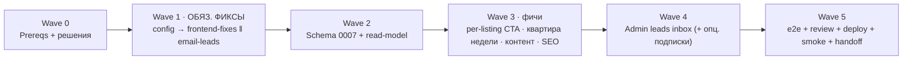

# Stage W2 — «Conversion & Polish» · План для Claude Code

> **Дата:** 2026-06-21 · **Проект:** otz-rent-finder · **Ветка:** `feature/web-conversion-polish`
> **База:** работающий сайт из Stage W (`src/site/*`, миграция 0006, Caddy, `otz-site.service`).
> Контекст: `HANDOFF.md`, `docs/SPEC.md`, `docs/web/ARCHITECTURE.md`, `docs/web/DATA_CONTRACT.md` (+ дельта `DATA_CONTRACT-W2.md`), дизайн в `design/`.
> **Методология:** **obra/superpowers** (обязательно) · multi-agent · TDD (red/green) · код-ревью на каждом шаге.

**Цель:** починить неприятные баги стартовой страницы и добавить конверсионные фичи (Telegram-CTA везде, e-mail заявок, «квартира недели», заявка по конкретной квартире, контентные страницы под ВНЖ, SEO). Развязка и инфраструктура — те же, что в Stage W.

---

## ⛔ Блок обязательных фиксов (приоритет этапа)

Пять багов, которые должны быть закрыты обязательно. Каждый — с точным файлом, критерием приёмки и тестом (детали в волнах ниже).

| # | Баг | Файл(ы) | Фикс |
|---|---|---|---|
| **F1** | Заголовок «ПО-ЧЕЛОВЕЧЕСКИ» читается как нытьё | `templates/index.html` (hero `<h1>`) | Заменить на **«КЛЮЧИ ОТ БЕЛГРАДА»** (дефолт; альт: «СВОИ В БЕЛГРАДЕ», «ДОМ ПОД ВНЖ»). Убрать ручной перенос `ПО-/ЧЕЛОВЕЧЕСКИ`. Casing/transform — как в текущем h1. |
| **F2** | Поле «РАЙОН» — свободный ввод | hero `.searchbar` в `index.html` · фильтр в `partials/_filters.html` · `app.py` (Jinja-global со списком районов) | Выпадающий список районов Белграда (searchable combobox, токенами; `<select>`-fallback без JS). Источник — `data/districts.yaml` (полный курированный список) ∪ фасеты (районы с листингами + счётчики). |
| **F3** | Стат «комиссия с тебя €0» (ложь) | `templates/index.html` (`.stat-row`, 3-й стат) | Заменить значение `€0` → **`50%`**, label сделать честным: «комиссия за подбор». Точные условия (50% от чего, разово/при заселении) — **уточнить у Дарьи в W0**, в копию не выдумывать; на странице «Как работаем» — расшифровка. Первые два стата (квартиры/районы) остаются динамическими из фасетов. |
| **F4** | Заявки уходят только в бот | `src/site/leads.py` · `src/config.py` · deps | Заявки **обязательно** уходят на **`d.mashukova@bk.ru`** (e-mail, новый канал). Бот-нотис Дарье оставить как второй канал. Lead сохраняется даже при сбое e-mail. |
| **F5** | Нет постоянной кнопки «Написать в Telegram» | `templates/base.html` · `static/css/site.css` · `app.py` (Jinja-global `telegram_url`) | Кнопка **«Написать в Telegram» → `https://t.me/Darya_kralj`** на **каждой** странице: в шапке, в футере и плавающая липкая (низ-право, mobile-safe). Палитра бренда (navy/oxblood), моно-SVG-глиф Telegram, без эмодзи. |

> «По вкусу» (фичи F→features) идут после фиксов: см. Wave 3–4. Обязательный блок (F1–F5) закрывается в Wave 1, до фич.

---

## 0. Superpowers — как используем (обязательно)

Установка (если ещё не стоит): `/plugin install superpowers@claude-plugins-official` (или маркетплейс автора — см. план Stage W §0.1). Скиллы триггерятся сами. Карта на фазы:

| Скилл | Где |
|---|---|
| `using-superpowers` | корневой раннер + чек-лист фаз |
| `brainstorming` | Wave 0 — финал спорных решений (копия заголовка, SMTP, условия комиссии) |
| `writing-plans` | этот файл (bite-sized задачи, TDD, частые коммиты) |
| `using-git-worktrees` | Wave 0 — worktree ветки `feature/web-conversion-polish` |
| `subagent-driven-development` | Waves 1–4 — свежий implementer-субагент на **задачу** + task-review после каждой |
| `dispatching-parallel-agents` | Wave 1 — независимые фиксы параллельно |
| `test-driven-development` | каждая задача с логикой — **сначала падающий тест** |
| `requesting-code-review` / `receiving-code-review` | ревью-гейт после задачи + широкое в Wave 5 |
| `systematic-debugging` | баги в Wave 5 и на проде |
| `verification-before-completion` | перед закрытием каждой волны/этапа |
| `finishing-a-development-branch` | Wave 5 — мерж, очистка worktree |

«Вкусовые» UI-скиллы из дизайн-плана (`taste-skill`, `impeccable`) — ревью внешнего вида новых экранов в Wave 3/5.

---

## 1. Правила оркестрации

1. **Worktree** (`using-git-worktrees`), ветка `feature/web-conversion-polish`; прод-ветку не трогать до Wave 5.
2. Волны последовательны; независимые задачи внутри волны — параллельно (`dispatching-parallel-agents`).
3. **TDD-закон:** нет прод-кода без предшествующего падающего теста. Чистая вёрстка/копирайт/конфиг — исключения, помечены в задаче.
4. **Subagent-driven:** каждая задача — свежий implementer с **сконструированным** контекстом (историю сессии не наследует) → task-review (спека + качество) → дальше. Широкое ревью ветки — Wave 5.
5. **Файловое владение:** агент меняет только файлы своего брифа; параллельные агенты не делят файл (карты владения в волнах). `routes.py` — горячая точка: в фич-волнах правит **один** агент за раз (поэтому Wave 3/4 идут цепочкой задач, а не двумя агентами на `routes.py`).
6. **Alembic single-owner:** все миграции — Wave 2, один агент. Нумерация продолжает проектную: Stage W = `0006`, этот этап = **`0007`**.
7. Субагенты НЕ делают: `git commit/push`, `ssh`, действия на VPS, правки серверного `.env`, файлы вне scope.
8. Коммитит оркестратор, атомарно: `stage-w2: <wave>/<task> — <summary>`.
9. Gate после волны (`verification-before-completion`): весь сьют зелёный (`.venv/bin/pytest tests/ -q`), линт чистый.
10. VPS-действия (Wave 0 prereqs, Wave 5) — только оркестратор, после подтверждения пользователя. Деплой = **rsync** (`scripts/deploy_sync.sh`), не git; серверный `.env` — руками.
11. Стиль: лаконичные комментарии только для WHY; model id без date-суффиксов; ничего не публиковать в @RentBelgrad из кода; никаких площадочных URL/TG-CDN в публичной выдаче (политика ToS, Stage W).

### Карта волн



| Волна | Режим | Содержание | Gate |
|---|---|---|---|
| W0 | человек+оркестратор | решения (копия, SMTP, условия комиссии), worktree, Superpowers | решения зафиксированы |
| W1 | config → **parallel ×2** | F1–F3,F5 (frontend) ‖ F4 (email) | pytest |
| W2 | sequential, 1 агент | миграция 0007 (`is_featured`, lead `site_listing_id`+`kind`) + read-model | pytest + upgrade/downgrade |
| W3 | sequential (цепочка задач) | per-listing заявка · реальная «квартира недели» · «ВНЖ и договор»/«Как работаем» · SEO | pytest |
| W4 | sequential | admin leads inbox; опц. подписки (вне DoD) | pytest |
| W5 | оркестратор+ssh | e2e новых флоу · a11y · широкое ревью · deploy · smoke · доки | smoke-чеклист |

**Метки:** S/M/L · риск 🟢/🟡/🔴.

---

## 🧭 Wave 0 — Prereqs и решения (человек + оркестратор)

Без app-кода. Записать ответы в `docs/web/DECISIONS-W2.md` (`brainstorming`).

- **F1 — копия заголовка:** дефолт **«КЛЮЧИ ОТ БЕЛГРАДА»**; подтвердить или выбрать альт. Подзаголовок оставить («Помогаем релокантам найти жильё на длинный срок — с договором, который проходит на ВНЖ и белый картон»).
- **F3 — условия комиссии:** уточнить у Дарьи точную формулу (50% от месячной аренды? разово? только при заселении?) — нужно для расшифровки на «Как работаем». В стат выводим ровно `50%`.
- **F4 — SMTP-релей:** какой использовать для отправки на `d.mashukova@bk.ru`. Нужны host/port/user/password/from. **Deliverability:** настроить SPF/DKIM для отправляющего домена (иначе bk.ru уронит в спам). Получение на bk.ru — без настроек. Креды кладутся в серверный `.env` руками (W5).
- **F5 — подтвердить** хэндл Дарьи `@Darya_kralj` (ссылка `https://t.me/Darya_kralj`).
- **Список районов (F2):** подтвердить, что `data/districts.yaml` даёт полный человекочитаемый список (Врачар, Дорћол, …); порядок в дропдауне — по популярности/алфавиту.
- **Worktree + Superpowers** готовы.

**Выход:** `docs/web/DECISIONS-W2.md` заполнен; SMTP-креды и DNS/SPF в работе.

---

## 🔧 Wave 1 — ОБЯЗАТЕЛЬНЫЕ ФИКСЫ

### W1-0 · Конфиг (оркестратор, sequential, первым) — `S` · 🟢
Добавить в `src/config.py` (pydantic-settings) и `.env.example` все новые ключи разом, чтобы параллельные агенты их потребляли (значения — в `env.additions-w2.txt`):
`SITE_TELEGRAM_URL` (=`https://t.me/Darya_kralj`), `SITE_LEAD_EMAIL_TO` (=`d.mashukova@bk.ru`), `SITE_SMTP_HOST/PORT/USER/PASSWORD/FROM/STARTTLS`. Коммит. (Конфиг — единственная общая точка W1; после неё A и B не делят файлы.)

### Карта владения W1

| Агент | Владеет | Запрещено |
|---|---|---|
| **A · frontend-fixes** | `templates/base.html`, `templates/index.html`, `templates/partials/_filters.html`, `static/css/site.css`, `static/js/combobox.js` (новый), `src/site/app.py` (Jinja-globals), `tests/site/test_render.py` | `leads.py`, `config.py`, `routes.py` |
| **B · email-leads** | `src/site/leads.py`, `src/site/email.py` (новый), `pyproject.toml`/deps, `tests/site/test_leads_email.py` | `templates/*`, `app.py`, `config.py` |

### Агент A · `frontend-fixes`

#### W1-A1 · F1 заголовок — `S` · 🟢 (копирайт/вёрстка)
Заменить текст hero `<h1>` на «КЛЮЧИ ОТ БЕЛГРАДА» (или выбранную в W0 альтернативу), убрать ручной перенос. **Смоук-тест:** рендер index содержит новый текст и не содержит «ПО-ЧЕЛОВЕЧЕСКИ».

#### W1-A2 · F2 дропдаун районов — `M` · 🟡
- `app.py`: Jinja-global/контекст-процессор `district_options` — курированный список из `data/districts.yaml` (человекочитаемые, дедуп, сортировка); при наличии фасетов — со счётчиками (переиспользовать `readmodel.facets()`).
- hero `.searchbar`: сегмент «РАЙОН» → searchable combobox (`static/js/combobox.js`, accessible, клавиатура, токенами) с `<select>`-fallback (значения = `district_options`); выбор → `/catalog?district=<...>`.
- `partials/_filters.html`: фильтр района → тот же combobox, мультивыбор со счётчиками.
- Combobox — донор из дизайн-плана (21st.dev) **обязательно перекрасить в токены**, дефолтные стили не тащить.

**Тесты:** рендер index/_filters содержит `<select>`/options из `district_options`; пустой каталог → fallback к полному списку из yaml; combobox.js деградирует в native select без JS (проверка наличия `<select>`).

#### W1-A3 · F3 комиссия 50% — `S` · 🟢
3-й стат: значение `€0` → `50%`, label → «комиссия за подбор». Первые два стата (квартиры/районы) — динамические из фасетов; при 0 — graceful (см. note). **Смоук-тест:** index содержит `50%` и не содержит `€0`-комиссии.

#### W1-A4 · F5 Telegram-CTA везде — `M` · 🟢
- `app.py`: Jinja-global `telegram_url` (=`SITE_TELEGRAM_URL`) — доступен всем шаблонам.
- `base.html`: кнопка «Написать в Telegram» (→ `telegram_url`) в шапке + ссылка в футере + **плавающая липкая** кнопка (низ-право, `position:fixed`, `env(safe-area-inset-*)`, не перекрывает контент, скрывается при наведении на футер — опц.). Палитра navy/oxblood, inline-SVG глиф Telegram (моно), без эмодзи. `rel="noopener"`, `target="_blank"`.
- `static/css/site.css`: стили кнопок + липкой (responsive: на мобиле — icon-only).

**Тесты:** рендер любой страницы (через `base.html`) содержит ссылку `https://t.me/Darya_kralj` в шапке, футере и липкой кнопке (3 вхождения/наличие селекторов). `prefers-reduced-motion` уважается.

### Агент B · `email-leads`

#### W1-B1 · F4 e-mail заявок на d.mashukova@bk.ru — `M` · 🟡
- `src/site/email.py` (новый): `async send_lead_email(lead, *, apartment=None)` через **aiosmtplib** (async, в стек) — добавить `aiosmtplib` в deps. STARTTLS по `SITE_SMTP_STARTTLS`. Тема: «Новая заявка с сайта RentBelgrad — {name}». Тело (text + простой html): все поля заявки (+ блок «квартира» когда есть `apartment` из W3). From = `SITE_SMTP_FROM`, To = `SITE_LEAD_EMAIL_TO`.
- `src/site/leads.py`: после сохранения lead — **сначала e-mail** (`send_lead_email`), затем бот-нотис Дарье (как было). Оба в try/except: lead уже сохранён, сбой канала логируется, пользователю всегда успех. Опц. лёгкий retry на временную SMTP-ошибку.

**Тесты (мок `aiosmtplib.send`):** валидная заявка → `send` вызван с верными To/Subject и полями в теле + бот-нотис вызван; SMTP бросает → lead всё равно сохранён, пользователь получает успех, ошибка залогирована; honeypot заполнен → ни записи, ни письма. Покрыть, что письмо уходит именно на `d.mashukova@bk.ru`.

**Gate W1:** pytest зелёный; ручной прогон dev-сервера — заголовок новый, дропдаун районов работает, стат `50%`, Telegram-кнопки на всех страницах. (Реальная отправка письма — в Wave 5 smoke с боевым SMTP.)

---

(продолжение — Waves 2–5, debug, шаблон субагента, DoD — во второй части ниже)

---

## 🧱 Wave 2 — Schema + read-model (агент `schema-readmodel`, sequential)

Один агент: alembic-цепочка. TDD на всё, кроме DDL-ревизии.

**Владение:** `alembic/versions/0007_*.py` (новый), `src/db/models.py`, `src/site/readmodel.py`, `tests/test_migration_0007.py`, `tests/site/test_readmodel_w2.py`.

### W2-1 · Миграция 0007 — `S` · 🟡
- `site_listings.is_featured BOOL default 0` + partial index `WHERE is_featured=1` (для быстрого выбора «квартиры недели»).
- `leads.site_listing_id INT null FK→site_listings` (заявка по конкретной квартире) + `leads.kind TEXT default 'general'` (`general` | `listing` | `subscription`).

**AC:** `upgrade head`/`downgrade -1` на копии схемы; `models.py` синхронизирован; старые миграции не тронуты; тест проверяет колонки/индекс/дефолты/FK.

### W2-2 · Read-model дополнения — `S` · 🟢
- `readmodel.featured_one() -> SiteListingView | None`: самый свежий `is_public AND is_featured`; если таких нет → самый свежий public; если каталог пуст → `None` (тогда hero-карточка остаётся плейсхолдером «скоро здесь»).
- `readmodel.apartment_summary(site_listing_id) -> dict | None`: краткая сводка квартиры (id, цена, район, площадь, ссылка) — для письма/нотиса по per-listing-заявке.

**Тесты:** featured отдаёт featured прежде newest; пустой каталог → None; `apartment_summary` для приватного → None.

---

## 🎯 Wave 3 — Конверсионные фичи (цепочка задач, свежий агент на каждую)

Идут последовательно: `routes.py`/`index.html`/`apt.html` — общие, параллелить нельзя без дробления. Каждая задача — свой implementer + review (`subagent-driven-development`).

### W3-1 · Заявка по конкретной квартире — `M` · 🟡 (фича: конверсия)
Telegram-DM с пред-заполненным текстом для user-аккаунта Telegram не поддерживает, поэтому контакт по квартире — через форму с контекстом (трекается, обогащает письмо/нотис).
- `partials/_card.html` + `apt.html`: кнопка «Оставить заявку на эту квартиру» → открывает форму заявки с **скрытым `site_listing_id`** (модалка или `/?lead=apt&apt=<id>` с прокрученной формой). `static/js/lead.js` — проставить `site_listing_id`.
- `routes.py` `POST /lead`: принять опц. `site_listing_id` (валидация: существует и `is_public`), `kind='listing'`.
- `leads.py`/`email.py`: если `site_listing_id` задан → подтянуть `apartment_summary`, добавить блок «Квартира: {цена}€, {район}, ссылка» в письмо **и** бот-нотис.

**Тесты:** карточка/деталь содержит кнопку с `site_listing_id`; `POST /lead` с валидным id → lead.kind='listing' + apartment-блок в письме (мок); невалидный/приватный id → заявка как general (или 422 — выбрать, покрыть тестом).

### W3-2 · Реальная «Квартира недели» — `M` · 🟢 (фича + оживляет главную)
- `src/admin/routes.py` + `src/admin/templates/*`: тоггл «Квартира недели» (`is_featured`) на матче/листинге, CSRF (паттерн H1). 
- `routes.py` (index) или `app.py`-global: передать `featured = readmodel.featured_one()`.
- `templates/index.html`: hero side-card (сейчас «КВАРТИРА НЕДЕЛИ / СКОРО ЗДЕСЬ») рендерит реальную квартиру (фото, цена моноширинным, район, ссылка «подробнее» → `/apt/{id}`); при `featured=None` — текущий плейсхолдер. Navy-градиент карточки сохранить (бренд), без фиолетового.

**Тесты:** admin-тоггл ставит/снимает `is_featured` идемпотентно (CSRF: без токена 403); index с featured → карточка с ценой/ссылкой; без featured → плейсхолдер.

### W3-3 · Контентные страницы «ВНЖ и договор» + «Как работаем» — `M` · 🟢 (фича: доверие/SEO)
Ссылки в навигации уже есть — сделать реальными страницами.
- `routes.py`: `GET /vnj` → `templates/vnj.html`, `GET /how` → `templates/how.html`. `base.html`-навигация ведёт на них.
- Контент (структура; **точные юридические детали выверяет Дарья** — в плане каркас, не выдумывать факты):
  - **«ВНЖ и договор»:** что делает договор аренды пригодным для ВНЖ/белого картона в Сербии; чек-лист «что должно быть в договоре»; частые ошибки; почему «по-серому» не проходит.
  - **«Как работаем»:** шаги (заявка → подбор → просмотр → договор → заселение); **расшифровка комиссии 50%** (формула из W0); чем отличаемся (курация, без накрутки, проверенные арендодатели).
- Стиль — «Belgrade Editorial», моноширинные акценты, кириллица.

**Тесты:** `/vnj` и `/how` → 200 + правильный шаблон; навигация в `base.html` резолвится (нет битых ссылок); ключевые блоки присутствуют (чек-лист, расшифровка комиссии). `taste-skill`-ревью.

### W3-4 · SEO-минимум — `M` · 🟢 (фича: дистрибуция в Telegram-аудиторию)
- `apt.html` `<head>`: OpenGraph на карточку (`og:title` = «{цена}€ · {район}», `og:description`, `og:image` = первое фото, `og:url`) — богатые превью при шеринге ссылки в Telegram. Canonical.
- `routes.py`: `GET /sitemap.xml` (статические страницы + все `is_public` `/apt/{id}`), `GET /robots.txt` (allow + ссылка на sitemap), кастомный **404-handler** → `templates/404.html` (стилизованная, с Telegram-CTA и ссылкой в каталог).

**Тесты:** рендер `/apt/{id}` содержит og-теги с ценой/районом/картинкой; `/sitemap.xml` — валидный XML, только public-url, static-страницы есть; `/robots.txt` отдаётся; несуществующий путь → 404 + `404.html`.

**Gate W3:** pytest зелёный; ручная проверка новых экранов и шеринга карточки.

---

## 📥 Wave 4 — Admin leads inbox (+ опц. подписки)

### W4-1 · Входящие заявки в админке — `M` · 🟢 (фича: операционка для Дарьи)
- `src/admin/routes.py` + `src/admin/templates/*`: страница `/admin/leads` — список заявок (новые сверху), поля (имя, контакт, бюджет, районы, комнаты, сообщение, квартира если `kind='listing'`, дата), смена `status` (`new`→`contacted`→`closed`) POST с CSRF. Фильтр по статусу. Read/write — БД админки (уже есть доступ).

**Тесты:** список рендерит заявки; смена статуса меняет строку; CSRF без токена → 403; per-listing-заявка показывает квартиру.

### W4-2 · (ОПЦИОНАЛЬНО, вне DoD) Подписка «сообщить о новых» — `M` · 🟡
Если будет время: на пустом результате каталога/в фильтрах — «оставить e-mail, пришлём новые подходящие». Захват → `leads(kind='subscription', message=<критерии>)` (или таблица `subscriptions`). Ночной шаг (переиспользует существующий nightly-таймер проекта) шлёт дайджест новых `is_public`-листингов подписчикам через `email.py`. **Дайджест-джоб — стретч**; на MVP достаточно захвата подписки. Зафиксировано, чтобы не потерять; в Definition of Done не входит.

---

## 🚀 Wave 5 — e2e + review + deploy + smoke + handoff (оркестратор + ssh)

> Правила §0.4 HANDOFF дословно: rsync не git; `.env` руками; `data/` rsync'ом не трогать. Каждый ssh — после подтверждения пользователя.

### W5-1 · e2e новых флоу (Playwright) + a11y — `M` · 🟢
- e2e: заголовок сменился; дропдаун районов выбирает и фильтрует; стат `50%`; Telegram-кнопка ведёт на `t.me/Darya_kralj` (шапка/футер/липкая); per-listing-заявка проставляет квартиру; «квартира недели» отображается; `/vnj`,`/how`,`/sitemap.xml`,`/robots.txt`,404 отдаются; форма заявки → success (SMTP замокан в e2e).
- a11y (`impeccable`): новые элементы — контраст AA, фокус-кольца, `alt`, клавиатура (combobox, форма), `prefers-reduced-motion`. Lighthouse не упал относительно Stage W.

### W5-2 · Широкое код-ревью ветки (`requesting-code-review`)
Безопасность (e-mail: креды только из env, не в логах/коде; lead не теряется при сбое; CSRF на admin/форме; rate-limit заявок; read-only-гарантия пайплайн-таблиц сохранена; нет площадочных URL наружу), корректность, тесты. Находки → фикс → `verification-before-completion`.

### W5-3 · Deploy + smoke
1. Локально: `.venv/bin/pytest tests/ -q` зелёный; e2e зелёные.
2. **Backup БД:** `ssh root@90.156.254.159 'cp /opt/otz/data/otz.db /opt/otz/data/backups/otz-$(date +%F-%H%M).db'`.
3. `bash scripts/deploy_sync.sh` (rsync кода; `data/`/`.env`/`.session` исключены).
4. **Зависимости:** на сервере обновить venv (`aiosmtplib`): `ssh ... 'sudo -u otz bash -c "cd /opt/otz && uv sync"'` (или pip-install в `.venv`).
5. **Серверный `.env`** (руками): дописать ключи из `env.additions-w2.txt` (SMTP-креды, `SITE_LEAD_EMAIL_TO=d.mashukova@bk.ru`, `SITE_TELEGRAM_URL=https://t.me/Darya_kralj`).
6. Миграция: `ssh ... 'sudo -u otz bash -c "cd /opt/otz && .venv/bin/alembic upgrade head"'`.
7. `systemctl restart otz-site.service`; `journalctl -u otz-site -n 30` — чистый старт.
8. **Smoke:**
   - заголовок «КЛЮЧИ ОТ БЕЛГРАДА» на главной; стат показывает `50%`; дропдаун районов работает;
   - Telegram-кнопка на главной/каталоге/карточке/404 ведёт на `https://t.me/Darya_kralj`;
   - **боевая отправка заявки** через форму → письмо пришло на `d.mashukova@bk.ru` (+ бот-нотис Дарье); проверить SPF/DKIM (не спам);
   - заявка по конкретной квартире → в письме есть блок «Квартира»;
   - «Квартира недели» (после admin-тоггла) видна на главной;
   - `/vnj`,`/how` открываются; шеринг ссылки `/apt/{id}` в Telegram даёт превью (OG);
   - админка (:8000) по-прежнему недоступна снаружи; монитор/nightly не задеты.
9. Обновить доки: `HANDOFF.md` (новые env-ключи SMTP/email/telegram, `is_featured`, lead-поля, e-mail-канал заявок), `docs/SPEC.md` (Stage W2 в «Этапах»), `README.md`, `.env.example` (см. `env.additions-w2.txt`), `docs/web/DATA_CONTRACT.md` (применить дельту из `DATA_CONTRACT-W2.md`).
10. `finishing-a-development-branch`: мерж `feature/web-conversion-polish`, очистка worktree, тег.

**Rollback:** код — `git revert` + `deploy_sync.sh`; схема — `alembic downgrade -1`; e-mail-сбой не критичен (lead сохраняется в БД, виден в admin inbox).

---

## 🐞 Debug-протокол (`systematic-debugging`)

Баг → гипотеза → изоляция (`pytest -k <name> -x`) → фикс → **регресс-тест в том же PR**.

| Симптом | Первый шаг |
|---|---|
| Письмо не уходит на bk.ru | `journalctl -u otz-site`; SMTP host/port/creds в env? STARTTLS верный? релей доступен с VPS (egress)? |
| Письмо уходит, но в спам | SPF/DKIM для From-домена; From не должен быть `@bk.ru` без аутентификации; проверить заголовки |
| Заявка «потерялась» | она в БД (admin `/admin/leads`) — e-mail/бот вторичны; смотреть лог, мок vs боевой SMTP |
| Дропдаун районов пуст | `district_options` из `districts.yaml`? фасеты пусты → fallback к полному списку отрабатывает? |
| Telegram-кнопка не на всех страницах | она в `base.html` (шапка+футер+липкая) — страница точно наследует `base.html`? `telegram_url`-global зарегистрирован? |
| Стат всё ещё `€0` | hardcoded €0 в `index.html` заменён на `50%`? кэш страницы (`SITE_CACHE_TTL`) — сбросить/переждать TTL |
| «Квартира недели» не меняется | Дарья отметила `is_featured` в админке? `featured_one()` приоритезирует featured? кэш index |
| OG-превью не появляется в Telegram | абсолютные URL (`SITE_PUBLIC_BASE_URL`)? `og:image` доступен публично? Telegram кэширует — проверить через @WebpageBot |

**Не баги:** rented-карточки приглушены (так задумано); незамапленный район показан raw (лог `districts-report`); первые два стата `0` при пустом каталоге (нет public-листингов — это состояние данных, не код).

---

## 🤖 Шаблон промпта субагента (копировать оркестратору)

```text
Ты — implementer-субагент Claude Code на проекте otz-rent-finder, этап Stage W2 (фиксы + конверсия сайта).
Работаем по obra/superpowers: TDD (сначала падающий тест), затем минимальная реализация.

Контекст (прочитай ровно это, историю сессии оркестратора НЕ наследуешь):
- HANDOFF.md §0, §0.4, §16, §17
- docs/web/ARCHITECTURE.md, docs/web/DATA_CONTRACT.md (+ DATA_CONTRACT-W2.md — дельта этого этапа)
- твоя задача <ID> в docs/superpowers/plans/2026-06-21-web-conversion-polish.md
- дизайн-эталон (если вёрстка): design/index.html, design/tokens.css

Scope: меняешь ТОЛЬКО файлы из карты владения своей волны: <список>.
Запрещено: git commit/push, ssh, действия на VPS, правки .env, файлы вне scope,
изменения alembic (кроме агента schema-readmodel в Wave 2), и routes.py если им владеет другая задача.

Порядок: 1) прочитай связанный код/контракт; 2) НАПИШИ ПАДАЮЩИЙ ТЕСТ под AC, посмотри как падает;
3) минимальная реализация до зелёного; 4) рефактор; 5) прогони ВЕСЬ сьют: .venv/bin/pytest tests/ -q;
6) отчёт: изменённые файлы · тесты · риски · что проверить на проде.

Стиль: лаконичные комментарии только для WHY; model id без date-суффиксов; ничего не публиковать в @RentBelgrad;
никаких площадочных URL/TG-CDN в публичной выдаче. Вёрстка: анти-slop (design §0), цена/метраж моноширинным,
топонимы кириллицей, без эмодзи в UI. E-mail-креды — только из env, никогда в коде/логах.
```

---

## ✅ Definition of Done — Stage W2

**Обязательные фиксы:**
- [ ] F1: заголовок «ПО-ЧЕЛОВЕЧЕСКИ» заменён (дефолт «КЛЮЧИ ОТ БЕЛГРАДА»)
- [ ] F2: район — выпадающий список районов Белграда (combobox + `<select>`-fallback) в hero и фильтрах
- [ ] F3: стат комиссии = `50%` (не `€0`), расшифровка на «Как работаем»
- [ ] F4: заявки уходят на `d.mashukova@bk.ru` (e-mail) + бот-нотис; lead не теряется при сбое канала
- [ ] F5: «Написать в Telegram» → `https://t.me/Darya_kralj` на **каждой** странице (шапка + футер + липкая)

**Фичи:**
- [ ] Заявка по конкретной квартире (форма с `site_listing_id`, квартира в письме/нотисе)
- [ ] Реальная «Квартира недели» (admin `is_featured` → карточка на главной)
- [ ] Страницы «ВНЖ и договор» и «Как работаем» с реальным контентом
- [ ] SEO: OG на карточках, sitemap.xml, robots.txt, стилизованная 404
- [ ] Admin leads inbox (триаж new/contacted/closed)

**Качество/деплой:**
- [ ] TDD соблюдён; e2e новых флоу зелёные; a11y AA; Lighthouse не упал
- [ ] Read-only-гарантия пайплайн-таблиц сохранена; e-mail-креды только из env
- [ ] Прод: deps обновлены (`aiosmtplib`), `.env` дополнен, миграция 0007 применена после backup, `otz-site` перезапущен; **боевое письмо дошло на d.mashukova@bk.ru**; админка наружу недоступна; монитор/nightly не задеты
- [ ] Доки обновлены (`HANDOFF`, `SPEC`, `README`, `.env.example`, `DATA_CONTRACT` + дельта); ветка смержена
- [ ] `pytest -q` зелёный

---

## Приложение — сводная таблица задач

| ID | Задача | Волна | Слож. | Риск | Тип |
|---|---|---|---|---|---|
| W0 | Решения (копия, SMTP, комиссия), worktree | 0 | S | 🟢 | prereq |
| W1-0 | Конфиг (env-ключи) | 1 | S | 🟢 | fix-infra |
| W1-A1 | **F1** заголовок | 1 | S | 🟢 | **fix** |
| W1-A2 | **F2** дропдаун районов | 1 | M | 🟡 | **fix** |
| W1-A3 | **F3** комиссия 50% | 1 | S | 🟢 | **fix** |
| W1-A4 | **F5** Telegram-CTA везде | 1 | M | 🟢 | **fix** |
| W1-B1 | **F4** e-mail заявок → d.mashukova@bk.ru | 1 | M | 🟡 | **fix** |
| W2-1 | Миграция 0007 (is_featured, lead-поля) | 2 | S | 🟡 | schema |
| W2-2 | Read-model (featured, apartment_summary) | 2 | S | 🟢 | schema |
| W3-1 | Заявка по конкретной квартире | 3 | M | 🟡 | feature |
| W3-2 | Реальная «Квартира недели» | 3 | M | 🟢 | feature |
| W3-3 | Контент «ВНЖ и договор» / «Как работаем» | 3 | M | 🟢 | feature |
| W3-4 | SEO (OG, sitemap, robots, 404) | 3 | M | 🟢 | feature |
| W4-1 | Admin leads inbox | 4 | M | 🟢 | feature |
| W4-2 | Подписки «сообщить о новых» (опц.) | 4 | M | 🟡 | stretch |
| W5 | e2e · review · deploy · smoke · handoff | 5 | L | 🔴 | release |
